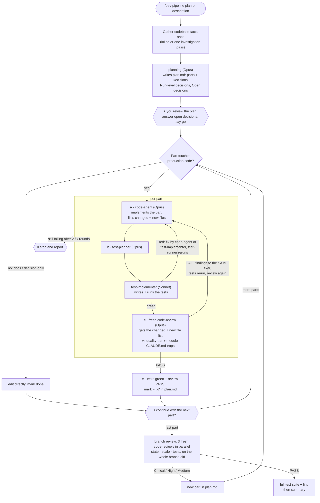

# `/dev-pipeline`: the main workflow

`/dev-pipeline` is the everyday way to build a change: it **plans, then implements, tests and reviews part by part**, with you approving the plan and each next part. Use it for anything from a bug fix to a multi-part feature. (`/feature`, see [feature.md](feature.md), is the variant for executing a plan someone already wrote, with a status board on disk.)

Source: `claude/commands/dev-pipeline.md`.

```
/devkit:dev-pipeline docs/plans/login-rework.md
/devkit:dev-pipeline Fix the sync so a deleted teammate's rows are skipped instead of failing the batch
```

## How it runs



## Rules that make it cheap and reliable
- **Plan first, code on your go.** The planning agent always writes `plan.md` (a plan file you pass in is read, never overwritten) as a checklist (`- [ ] Part N: … — files`) with a `Decisions:` list per part, a `## Run-level decisions` section (the deadline that bounds a run and the worst case of all retries and waits, one failure policy, shared state across parts) and an `## Open decisions` section. No implementation starts until you say so.
- **`plan.md` is the truth.** Its checkboxes say where work stopped, so running the command again skips planning and resumes at the first unchecked part, not from agent memory.
- **One agent per role, resumed.** Each role (`code-agent`, `test-planner`, `test-implementer`, `test-runner`) is spawned once and later parts resume it with `SendMessage`, so it keeps the plan and conventions in context. Every ~5 parts the agent writes a condensed summary and a fresh agent continues from it, which caps context growth.
- **Reviews stay independent.** `code-review` is spawned fresh for each part, so it is not anchored on earlier verdicts; within a part it is resumed for re-checks, and each pass re-checks the current diff instead of repeating its verdict.
- **One part at a time.** Parts run one after another, even independent ones: parallel agents in one checkout would overwrite each other's files and mix their diffs.
- **Facts gathered once.** Codebase investigation happens once and is handed to the planner, not repeated by a research agent and the planner side by side.
- **Docs-only fast path.** A part that changes no production code (docs, a recorded decision, issue text) skips review and tests.
- **Routing still applies.** The orchestrator never runs git, build or test commands itself; they go to `git-runner`, `os-agent` or `test-runner`.
- **Tests before review.** The reviewer sees the finished code and its tests, the latest test report, and the explicit list of changed and new files (new files are not in `git diff`).
- **Full test steps for every part.** Each part that changes behavior gets a `test-planner` plan and `test-implementer` tests, whatever its size.
- **Tests that can fail.** `test-planner` covers failure branches, boundaries and security cases, and marks tests that must fail without the change; `test-implementer` proves they do (red check) and never edits an expected value to make a test pass.
- **Done means green and reviewed.** A part is checked off in `plan.md` only after its tests pass and the review passes.
- **Fix rounds stay small.** A fix fixes only Critical, High and Medium findings the branch introduced. Design debt and pre-existing issues go to the plan's Follow-ups section; a fix that needs a new mechanism (budget, clock, flag, test seam, new type) goes back to `planning`.
- **Branch review at the end.** After the last part three fresh `code-review` agents check the whole branch diff in parallel, each with one lens: correctness and state (interactions between parts, one failure policy, state across runs, claims in comments and docs), scale and limits (worst-case time against every deadline, call rates against provider limits, rows at 10x), and tests (every guard has a test that goes red without it). A Critical, High or Medium finding becomes a new part.
- **Guards have tests.** `test-planner` writes a guard table (each new condition, filter or branch → the test that goes red when it is removed or flipped), with fixtures of two of each grouped thing and literal expected values; `code-review` spot-checks it.
- **State across runs and numbers in the plan.** The plan's run-level decisions answer, for every skip rule, dedup key, cache or watermark, what proves the earlier run was complete, what happens after a failed or partial run, and what repairs a wrong skip. External call loops and queries are planned with numbers: calls per minute against the provider's limit, rows at 10x, index, timeout, chosen retry policy.
- **Stop on repeated failure.** A part gets at most 2 fix rounds, test and review failures counted together; then the pipeline stops with a status report.

## Agent roster

| Step | Agent | Model |
|---|---|---|
| Plan | `planning` | Opus |
| Implement | `code-agent` | Opus |
| Review | `code-review` | Opus |
| Test plan | `test-planner` | Opus |
| Test code and run | `test-implementer` | Sonnet |
| Test reruns after a fix | `test-runner` | Haiku |
| Git / shell | `git-runner`, `os-agent` | Haiku |

## Quality
Before each review, `os-agent` runs the build and lint, so the reviewer judges tooling from a real run, not from `code-agent`'s summary; it also reads the code before that summary. `test-planner` writes its cases from the plan part first and reads the code second.

`planning`, `code-agent`, `test-implementer` and `code-review` all preload the `quality-bar` skill. `planning`, `code-agent` and `code-review` also read the `CLAUDE.md` of each module or package the change touches, which lists the known traps of that area.

`code-review` fails a part on any Critical, High or Medium finding. `code-agent` must hand off zero Critical and High and no Medium its part introduces; it does not add a mechanism only to prevent a Medium, and lists design-debt Mediums in its summary as follow-ups. When a change adds retries, waits, loops or timeouts, the reviewer computes the worst case against the deadline of the caller, also outside the diff.

If you run `/comprehensive-review:full-review` on the result, the pipeline passes it the plan's files as scope, the `quality-bar` severities, and asks it to tag each finding `introduced` or `pre-existing`. Judge the branch by Critical + High + introduced Medium, not by the total count.

## `/dev-pipeline` vs `/feature`

| | `/dev-pipeline` | `/feature` |
|---|---|---|
| Input | plan or a plain description | an existing plan file or GitHub issue |
| Planning | `planning` agent writes `plan.md` | never plans; the plan is input |
| Progress state | checkboxes in `plan.md` | `.claude/feature/status.md` + per-agent logs |
| Order per part | implement → test → review | implement → test → review |
| End of run | branch review, then full suite + lint | full suite + lint, then gated commit/push/PR |
| Worktree, commit, PR | not handled | creates branch/worktree; gated commit/push/PR |
