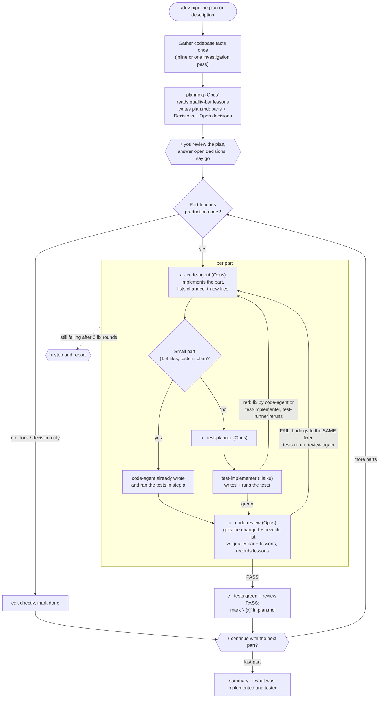

# `/dev-pipeline`: the main workflow

`/dev-pipeline` is the everyday way to build a change: it **plans, then implements, tests and reviews part by part**, with you approving the plan and each next part. Use it for anything from a bug fix to a multi-part feature. (`/feature`, see [feature.md](feature.md), is the heavier variant for executing a plan someone already wrote, with a status board on disk.)

Source: `claude/commands/dev-pipeline.md`.

```
/dev-pipeline docs/plans/login-rework.md
/dev-pipeline Fix the sync so a deleted teammate's rows are skipped instead of failing the batch
```

## How it runs



## Rules that make it cheap and reliable
- **Plan first, code on your go.** The planning agent always writes `plan.md` (a plan file you pass in is read, never overwritten) as a checklist (`- [ ] Part N: … — files`) with a `Decisions:` list per part and an `## Open decisions` section. No implementation starts until you say so.
- **`plan.md` is the truth.** Its checkboxes say where work stopped, so a session reset or restart resumes from the plan, not from agent memory.
- **One agent per role per track, resumed.** Each role (`code-agent`, `code-review`, `test-planner`, `test-implementer`, `test-runner`) is spawned once and later parts resume it with `SendMessage`, so it keeps the plan and conventions in context. Every ~5 parts the agent writes a condensed summary and a fresh agent continues from it, which caps context growth.
- **Reviews stay independent.** A resumed reviewer must re-check the current diff each pass, not repeat its earlier verdict.
- **Parallel tracks.** Parts that don't depend on each other run as separate tracks, each with its own agents, launched in parallel.
- **Facts gathered once.** Codebase investigation happens once and is handed to the planner, not repeated by a research agent and the planner side by side.
- **Docs-only fast path.** A part that changes no production code (docs, a recorded decision, issue text) skips review and tests.
- **Routing still applies.** The orchestrator never runs git, build or test commands itself; they go to `git-runner`, `os-agent` or `test-runner`.
- **Tests before review.** The reviewer sees the finished code and its tests, plus the explicit list of changed and new files (new files are not in `git diff`).
- **Done means green and reviewed.** A part is checked off in `plan.md` only after its tests pass and the review passes.
- **Stop on repeated failure.** A part gets at most 2 fix rounds, test and review failures counted together; then the pipeline stops with a status report.

## Agent roster

| Step | Agent | Model |
|---|---|---|
| Plan | `planning` | Opus |
| Implement (and small-part tests) | `code-agent` | Opus |
| Review | `code-review` | Opus |
| Test plan | `test-planner` | Opus |
| Test code and run | `test-implementer` | Haiku |
| Test reruns after a fix | `test-runner` | Haiku |
| Git / shell | `git-runner`, `os-agent` | Haiku |

## Quality and learning
`planning`, `code-agent` and `code-review` all preload the `quality-bar` skill, including its lessons from past reviews. `code-review` records new lessons itself (the orchestrator only relays its "Lessons recorded" list). If you run `/comprehensive-review:full-review` on the result, scope it to the plan's files and then run `/learn-from-review`. See [learning-loop.md](learning-loop.md).

## `/dev-pipeline` vs `/feature`

| | `/dev-pipeline` | `/feature` |
|---|---|---|
| Input | plan or a plain description | an existing plan file or GitHub issue |
| Planning | `planning` agent writes `plan.md` | never plans; the plan is input |
| Progress state | checkboxes in `plan.md` | `.claude/feature/status.md` + per-agent logs |
| Order per part | implement → test → review | implement → test → review |
| Worktree, commit, PR | not handled | creates branch/worktree; gated commit/push/PR |
