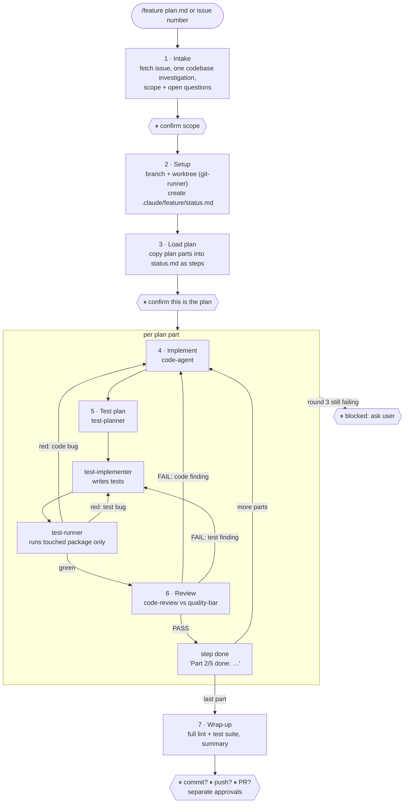

# `/feature`: the feature orchestrator

Source: `claude/skills/feature/SKILL.md`. For everyday work, prefer [`/dev-pipeline`](dev-pipeline.md); the comparison table is there.

`/feature` takes a plan someone already wrote (a Markdown file or a GitHub issue) and executes it part by part. The main thread acts only as **orchestrator**: it routes work, tracks state and talks to you. It never plans, writes production code, or runs git/shell/test commands itself; every task goes to a dedicated subagent.

```
/feature docs/plans/login-rework.md
/feature 142
```

## Ground rules
- **Never plan.** The plan is input. If it is missing, unclear or wrong, the orchestrator stops and asks.
- **Delegate, do not do.** Each role has one agent; tasks outside the roster go through `model-selector`.
- **Repo rules win.** The repo's `CLAUDE.md` (worktree naming, lint, tests) overrides the skill and is passed to every agent.
- **One agent per role, resumed.** Each agent is spawned once, its id is saved in `status.md`, and later steps resume it with `SendMessage`, so it keeps its context.
- **State lives in files.** Everything is on disk, so a session reset resumes where it stopped.
- **User gates (⏸).** It stops for your confirmation at fixed points and never commits, pushes or opens a PR without a separate approval for each.
- **Stop on repeated failure.** 3 failed fix rounds on one part: the step goes `blocked` and you decide.

## Agent roster

| Work | Agent | Model |
|---|---|---|
| Git / worktree | `git-runner` | Haiku |
| Shell | `os-agent` | Haiku |
| Implementation | `code-agent` | Opus |
| Review | `code-review` | Opus |
| Test planning | `test-planner` | Opus |
| Test writing | `test-implementer` | Haiku |
| Test running | `test-runner` | Haiku |

## Phases



Same loop, as the orchestrator sees it: every agent reports back to the orchestrator, which routes the fix or moves on.

```
                ┌──────────────────────── orchestrator (main thread) ────────────────────────┐
                │   reads status.md · routes work · forwards findings verbatim · gates ⏸     │
                └──┬───────────┬──────────────┬──────────────┬──────────────┬────────────────┘
                   │ part      │ part+files   │ test list    │ run          │ part+files
                   ▼           ▼              ▼              ▼              ▼
             ┌───────────┐ ┌────────────┐ ┌──────────────┐ ┌───────────┐ ┌─────────────┐
             │code-agent │ │test-planner│ │test-implement│ │test-runner│ │ code-review │
             │  (Opus)   │ │  (Opus)    │ │   (Haiku)    │ │  (Haiku)  │ │   (Opus)    │
             └─────┬─────┘ └─────┬──────┘ └──────┬───────┘ └─────┬─────┘ └──────┬──────┘
                   │ files,      │ test names    │ test files    │ pass/fail     │ PASS/FAIL +
                   │ risks       │ + intent      │               │ + errors      │ R<n> findings
                   └─────────────┴───────────────┴───────────────┴───────────────┘
                                               ▼
                                   back to orchestrator → next step
```

## Fix rounds
- **Test failure triage:** test matches the plan but code disagrees → `code-agent`; test broken or asserts something the plan does not say → `test-implementer`; unclear → `code-agent` decides which side is wrong.
- **Review findings** come as `R<n> <Critical|High|Medium|Low> <file:line> <problem> → <fix>`. Critical and High must be fixed; Medium is fixed or its skip is justified in `status.md`; Low is only logged.
- Findings are forwarded **verbatim with their ids**. The fixer answers per id: `fixed` or `disputed` (disputes the orchestrator can't settle go to you).
- After a fix: tests rerun, then the **same** reviewer re-checks only its ids and the new diff.
- Rounds are counted per part (`round 2/3`); round 3 still failing → `blocked`, ask the user.

## State on disk

```
<worktree>/.claude/feature/
├── status.md            # orchestrator's board: every step, its status, who is on it
├── plan.md              # only when the plan came from an issue
└── agents/
    ├── code-agent.md    # one file per agent, written only by that agent
    ├── test-planner.md
    └── ...
```

- `status.md` — written only by the orchestrator: input, branch/worktree, plan path, current phase, a **Steps** table (`not ready | ongoing | blocked | done`, agent, "doing now"), an **Agents** table (agentId, status file, current step) and decisions/open questions.
- `agents/<agent>.md` — each agent's own log (`working | done | failed | waiting`, doing now, timestamped log). Agents without a write tool (`code-review`) get theirs written by the orchestrator.
- On restart the orchestrator reads `status.md`, then the agent files of the ongoing step, and resumes.

